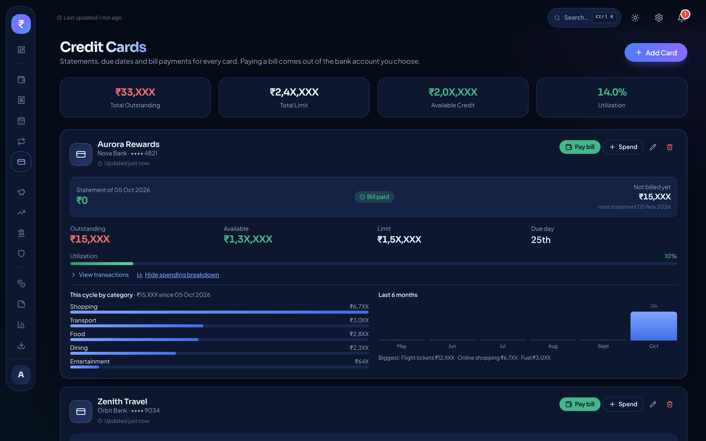
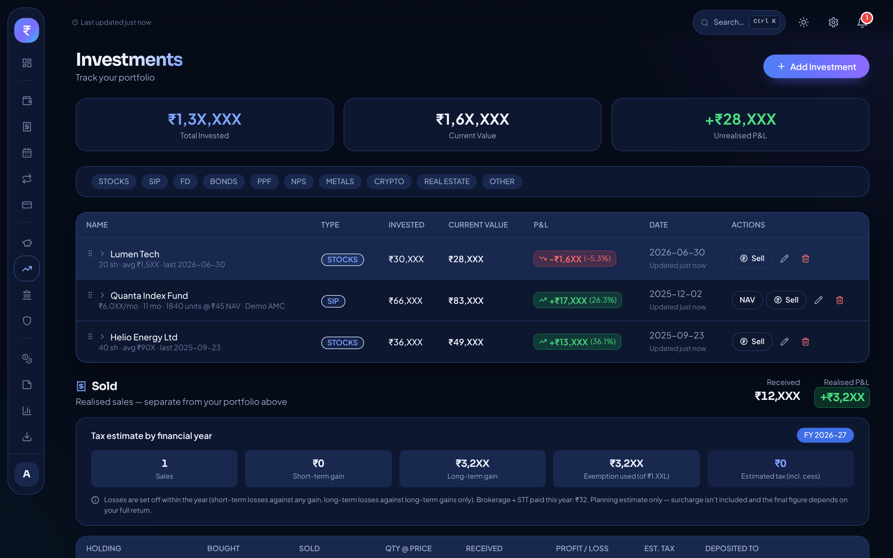
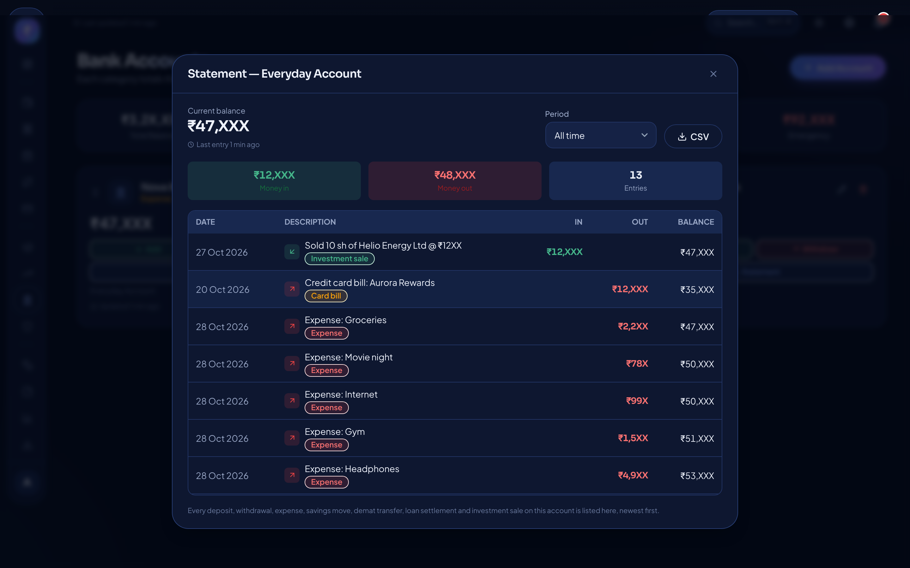
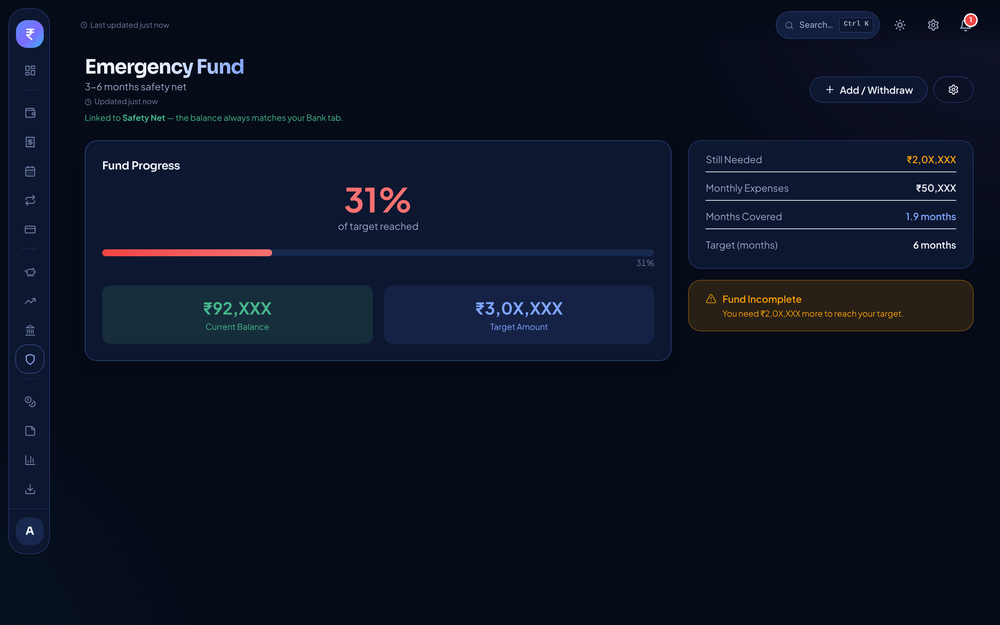
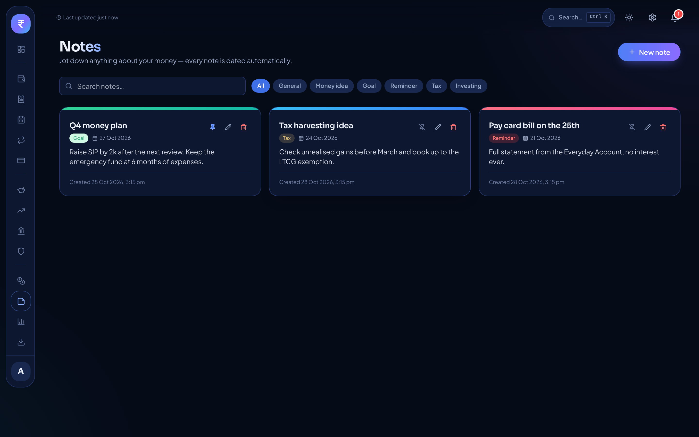
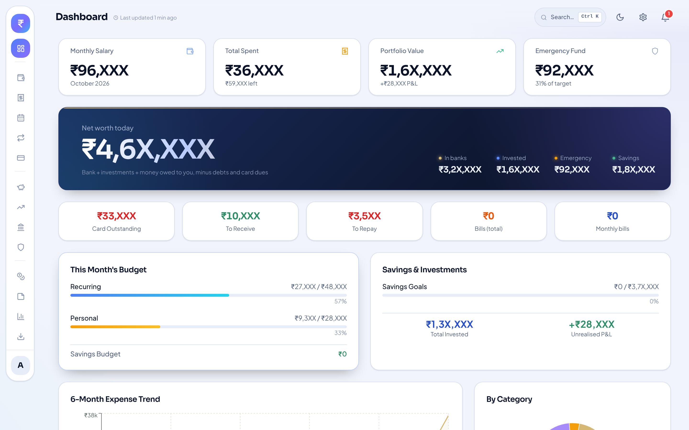

# WYLTH

**Grow quietly.**

A personal finance app for Windows that tracks your whole financial life and keeps every byte on your own PC.
No account. No internet. No cloud.

### [⬇ Download the latest installer](../../releases/latest)

> Screenshots use dummy data, and every amount is masked (only the first two digits are visible).

## Why WYLTH

Most money apps want your data, your email and your permissions, and their balances rarely match your bank.
WYLTH is built around two ideas:

- **Every rupee has a ledger entry.** Each bank balance is explained line by line, so the numbers always add up.
- **Your data never leaves your PC.** There is no server, no sign-up and no analytics.

## Features

- **Bank accounts:** a full ledger and downloadable statement for every account
- **Credit cards:** several cards, statement cycles, due-date alerts, a spending breakdown and a pay-bill button
- **Salary split:** divides income into needs, wants and investing
- **Expenses and monthly spending:** daily tracking with category and month views, paid from a chosen account
- **Recurring and bills:** rent, utilities and subscriptions, settled straight from the bank
- **Investments:** stocks, SIPs, FDs, bonds, PPF, NPS, metals and more, with profit and loss in green and red, a sell flow and an *estimated* capital-gains tax figure
- **Emergency fund and savings goals:** tied to real bank accounts so the values always match
- **Lending and debts:** per-person balances that net out
- **Notes:** dated notes for your money ideas
- **Analytics:** income vs spending, trends and allocation
- **Reminders** for bills and card dues
- **Export to Excel, backup and restore**
- **Password lock,** light and dark themes, `Ctrl + K` quick search, and a trash bin with restore

## How to install and use

You need a Windows 10 or 11 PC. Nothing else has to be installed first.

1. Open the **[Releases page](../../releases/latest)**.
2. Under **Assets**, download **`WYLTH Setup 1.0.0.exe`**.
3. Double-click the downloaded file. It installs in a few seconds and opens WYLTH.
4. **If Windows shows "Windows protected your PC":** click **More info**, then **Run anyway**.
   This message appears for any new app that is not code-signed. WYLTH has no network features.
5. On first launch, **set a password** (at least 4 characters). This locks the app each time you open it.
6. Start by adding your **bank accounts** (with today's balance), then add **credit cards**, **investments** and your **monthly expenses**.
7. Open WYLTH any time from the Start menu or desktop shortcut.

### Good habits

- **Back up regularly:** use the Export screen to save a backup file somewhere safe (a pen drive, for example).
- **Moving to a new PC:** restore that backup file in WYLTH on the new PC.
- **Updating:** download the newer installer and run it. Your data is kept.
- **Uninstalling:** use Windows Settings, then Apps, then WYLTH. Your data stays in your Windows user folder until you delete it yourself.

## Screenshots

| Credit cards | Investments |
|---|---|
|  |  |
| **Bank statement** | **Emergency fund** |
|  |  |
| **Notes** | **Light theme** |
|  |  |

## Privacy

WYLTH stores everything in a local database in your Windows user folder. The app has no online features and sends nothing anywhere.
Exports and backups are files you create yourself, so they stay on your machine unless you share them.

## Disclaimer

- The capital-gains figures are **planning estimates only** (Indian equity rules). They are not tax advice, and surcharge is not included.
- Remember your password. Keep regular backups so you never lose your data.

## Feedback

If WYLTH helps you, a star on this repo and some feedback mean a lot. Message me on [GitHub](https://github.com/itsrohit11) or LinkedIn.

## License

Free to use for personal, non-commercial purposes. **No modification or redistribution.** See [LICENSE](LICENSE).
